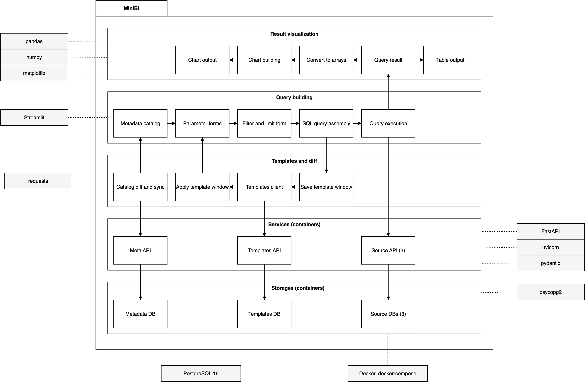
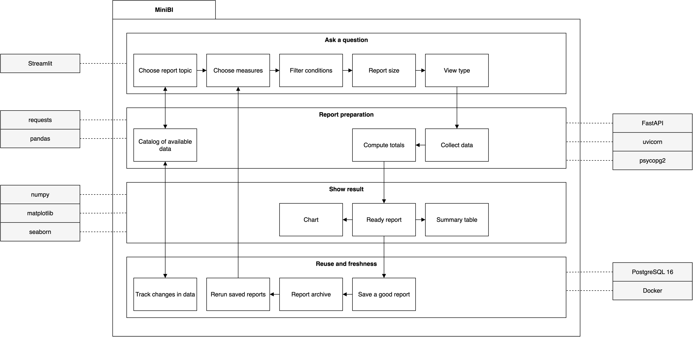
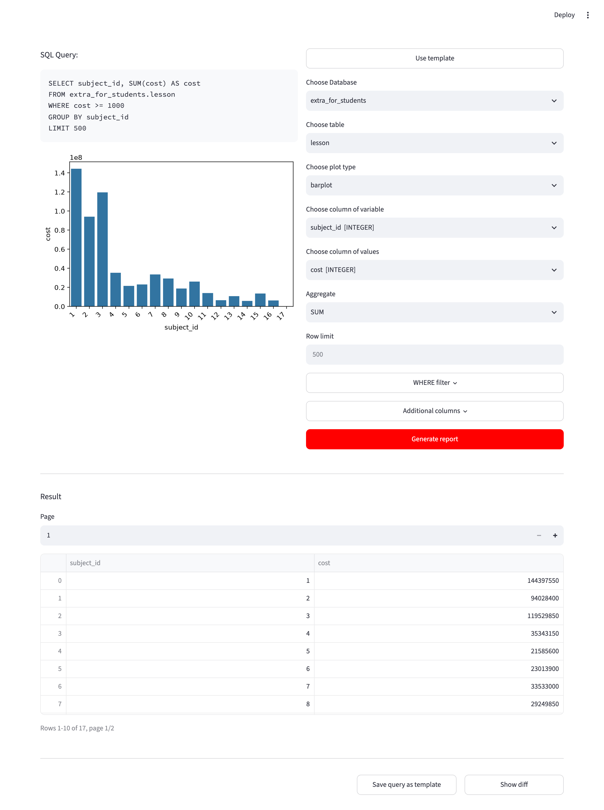
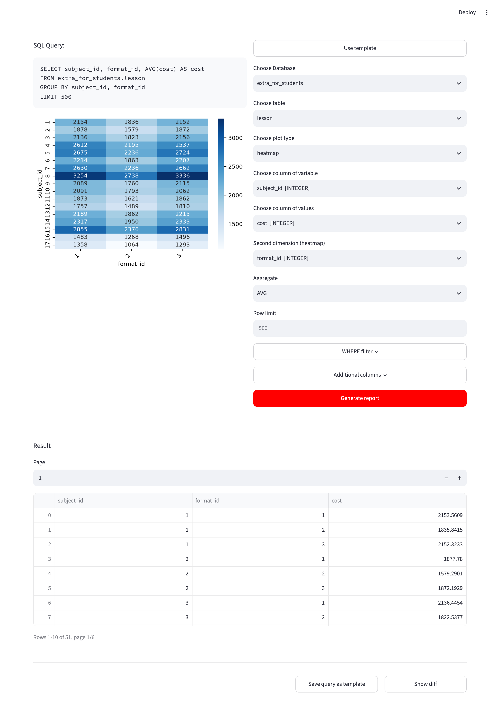
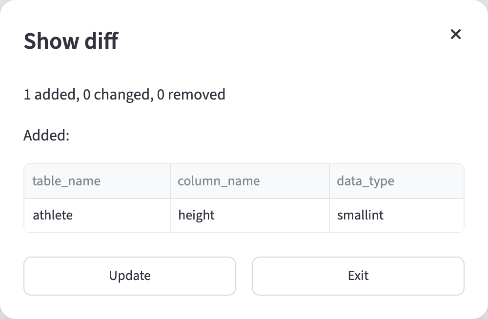

# MiniBI

MiniBI is a small business intelligence tool. It lets you build reports and
charts from several independent databases or from your own files without
writing SQL by hand.

## Overview

A system was developed that works with the metadata of independent PostgreSQL
databases. Each source database runs separately and is reached through its own
REST agent. A separate metadata database keeps a denormalized analog of the
information schema (meta.catalog), and a separate templates database keeps
saved queries.

The Streamlit interface builds a query from forms filled with catalog data:

- choose a database, a table, columns and an aggregate (SUM, AVG, COUNT)
- filter rows with WHERE conditions and limit the number of rows
- see the generated SQL, the result tables and a chart
  (barplot, pieplot, scatter, heatmap)
- save a query as a template and apply it again later
- compare the catalog with the live source schema and update it
- upload files (CSV, TSV, XLSX, XLS, ODS, JSON, Parquet, XML) and work with
  them the same way as with a database

## Architecture



Modules are grouped by interaction: query building, result visualization,
templates and diff, services and storages. External libraries are shown
outside the system frame.

## Business architecture



The same system described as business processes: ask a question, prepare the
report, show the result, reuse reports and keep data up to date.

## Examples

Total lesson cost by subject, only lessons that cost 1000 or more:



Average lesson cost by subject and format:



A new column found in a source by Show diff:



## Run with Docker

```
cp .env.example .env    # then set passwords and source URLs
docker compose up -d --build
```

The app opens at http://localhost:8501. Source databases are not part of this
stack, they run separately (see below). After the first start press Show diff
and Update to fill the catalog.

## Run locally

Start the metadata and templates services with Docker, then run only the app:

```
docker compose up -d meta-db meta-api templates-db templates-api
pip install -r app/requirements.txt
cd app && streamlit run app.py
```

## Add a database

Any PostgreSQL database can be added as a source:

1. Copy source-agent/agent.env.example to source-agent/<name>.env and set the
   connection to your database.
2. Start an agent for it:
   ```
   docker compose -p agent-<name> --env-file source-agent/<name>.env -f source-agent/docker-compose.yml up -d
   ```
3. Add the source id to SOURCES in .env and set SOURCE_<ID>_URL to the agent
   URL, for example SOURCE_MY_SOURCE_URL=http://localhost:8010.
4. Restart the app and the meta API, then open Show diff and press Update.
